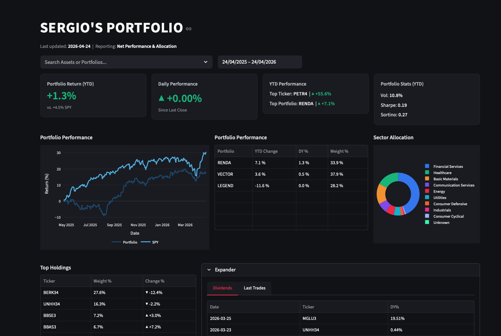

<!-- Hero -->
<h1 align="center">Portfolio Dashboard</h1>

<p align="center">
  <strong>Professional stock portfolio dashboard for interested investors, friends and family that would like to take a peek at my different portfolios.</strong>
</p>

<p align="center">
  <a href="https://github.com/sergiobk201/portfolio_dashboard/actions/workflows/daily_pipeline.yml"></a>
  <a href="https://github.com/sergiobk201/portfolio_dashboard/actions/workflows/tests.yml"></a>
  <a href="LICENSE"></a>
  <a href="https://github.com/sergiobk201/portfolio_dashboard/stargazers"></a>
  
</p>

<p align="center">
  
</p>

---

## ✨ Overview

This project provides an automated, investor-ready dashboard for tracking and reporting portfolio performance. It ingests trade, dividend, and price data from various sources (Gmail notifications, market APIs) into a centralized Supabase database, calculating institutional-grade metrics like Time-Weighted Return (TWR) and risk-adjusted ratios.

Built with a focus on transparency and professional aesthetics, it serves as a central hub for sharing portfolio insights with trusted parties while maintaining data integrity through daily automated refreshes.

## 🚀 Features

- 🔄 **Automated Pipelines** — One daily GitHub Actions run: official B3 closes → SPY benchmark → full performance recompute, gated by the test suite.
- 🏛 **Official Prices** — Session closes straight from B3's COTAHIST files (Yahoo / BRAPI only as labelled fallbacks), with provenance on every row.
- 🧾 **Audit-Grade Accounting** — Full-history rebuild on every run: raw closes, corporate actions, implied contributions, validation gates that block bad writes.
- 📊 **Quant Metrics** — Institutional performance tracking including TWR, Sharpe Ratio, and Sortino Ratio.
- 📉 **Risk-Free Integration** — Real-time risk-free rate alignment using 13-week US T-bill yields (^IRX).
- 🎨 **Interactive UI** — High-fidelity Streamlit dashboard with custom CSS and Plotly financial charts.
- 🔒 **Public Mode** — Integrated support for masking nominal currency figures for external reporting.
- 🏦 **Supabase Backend** — Centralized PostgreSQL storage for historical performance and trade ledgers.

## 📸 Live Portfolio 

> 🔗 **Click here:** (https://barkel-portfolio.streamlit.app) 

## 🏁 Quick Start

### 1. Clone the repository
```bash
git clone https://github.com/sergiobk201/portfolio_dashboard.git
cd portfolio_dashboard
```

### 2. Set up environment
Create a `.env` file with your Supabase and API credentials:
```env
host=your_db_host
port=5432
dbname=postgres
user=your_user
password=your_password
```

### 3. Install & Run
```bash
pip install -r requirements.txt
streamlit run public_app.py
```

## 📦 Installation

### Requirements
- Python 3.10+
- Supabase (PostgreSQL) account
- Gmail API credentials (for automation)

### Pipelines
`.github/workflows/daily_pipeline.yml` runs at 07:30 BRT (idempotent retry at 13:30):

| Step | Module | What it does |
|---|---|---|
| gate | `tests/` | Synthetic-data test suite; any failure blocks every write |
| prices | `prices_pipeline.py` | Fills every held (ticker, session) gap: B3 COTAHIST → Yahoo raw → BRAPI; marks confirmed no-trade sessions; syncs splits/bonuses |
| benchmark | `spy_pipeline.py` | SPY closes on NYSE sessions (FMP → Yahoo raw) |
| performance | `calculate_daily_twr.py` | Rebuilds the whole series from the ledger and writes only changed rows |

Shared modules: `portfolio_engine.py` (pure, vectorized accounting), `market_data.py` (calendars + providers), `db.py`, `alerts.py` (Telegram).
Ledger ingestion: `gmail_automation.py` (trades from notas de corretagem; fee math in `nota_fees.py`) and `dividends_pipeline.py`.

## 🛠 Usage

### Running Automation
Pipelines are designed to run via GitHub Actions but can be triggered manually:
```bash
cd pipelines
python prices_pipeline.py       # official closes for every held session
python spy_pipeline.py          # benchmark
python calculate_daily_twr.py   # full recompute → portfolio_performance

# One-off historical repair (needs sql/001 applied). Dry run by default.
python backfill_history.py --cache-dir ~/.cache/b3 --report /tmp/recon.md
python backfill_history.py --emit-sql /tmp/repair.sql    # or --apply

# Tests (synthetic data only)
pip install -r requirements-dev.txt && python -m pytest
```

### Dashboard Customization
The main dashboard is located in `public_app.py`. It uses a custom CSS injection to achieve a professional dark-themed "Institutional" look.

## 🏗 Architecture

The system is designed for modularity and vectorized performance:
- **Ingestion Layer:** Python scripts running in GitHub Actions.
- **Persistence Layer:** Supabase (PostgreSQL) for all time-series data.
- **Calculation Layer:** NumPy/Pandas-based TWR and risk metric engine.
- **Presentation Layer:** Streamlit v1 for interactive reporting.

## 📐 Methodology

- **Valuation** — raw session closes as printed by B3 (never dividend-adjusted). Income enters as cash on its payment date, so it is counted exactly once.
- **Corporate actions** — splits, reverse splits and bonus issues change share counts on the ex-date (`floor(shares × ratio)`; B3 pays the fractions in cash). Closes carried across an ex-date are rescaled.
- **Cash & contributions** — sale proceeds and income fund later buys; a buy beyond available cash implies an external contribution (closed form: `I_t = max(0, max_{s≤t} −C_t)` on cumulative net flows).
- **TWR** — daily, start-of-day flows, chain-linked: `r_t = V_t / (V_{t−1} + F_t) − 1`, identical to a unitised NAV where contributions buy units at the prior close. XIRR is reported alongside as the money-weighted view.
- **Gates** — an unpriced holding, a negative position or an unknown trade side blocks every write; stale prices, missing splits (> 40 % jump in the split-continuous series) and fractions with no recorded event raise alerts.
- **Provenance** — every price row carries its `source` (`b3_cotahist`, `b3_no_trade`, `yahoo_raw`, `brapi`, `legacy`, `manual`); fallback rows are upgraded to the official close automatically.
- **Known limits** — withdrawals are not modelled (the ledger has none); bonus-share *custo atribuído* is not in the IRPF cost basis.

## 🗺 Roadmap

- [x] Phase 1: Research & Setup
- [x] Phase 2: Streamlit Prototype
- [x] Phase 3: Reporting & Polish (Sharpe/Sortino)
- [x] Phase 4: Full "Public Mode" implementation

## 📝 Changelog

- **v0.4.0** — Rebuilt the performance engine (full recompute, corporate actions, official B3 closes, validation gates), consolidated the daily workflows, added the test suite and a guarded historical backfill.
- **v0.3.0** — Added advanced risk metrics (Sharpe, Sortino) and ^IRX integration.
- **v0.2.0** — Implemented full Supabase integration and daily GitHub Actions.
- **v0.1.0** — Initial Streamlit prototype with basic TWR tracking.

See [CHANGELOG.md](ai_tools/CHANGELOG.md) for the full history.

## 🤝 Contributing

Contributions are welcome. Feel free to open an issue or submit a pull request.

## 📄 License

[MIT](LICENSE) © 2026 Sergio B.K.

## 🙏 Acknowledgments

- Financial data powered by [Brapi](https://brapi.dev) & [yfinance](https://github.com/ranaroussi/yfinance).
- UI built with [Streamlit](https://streamlit.io).
- Calculations inspired by institutional TWR standards and common asset management risk-adjusted metrics.
